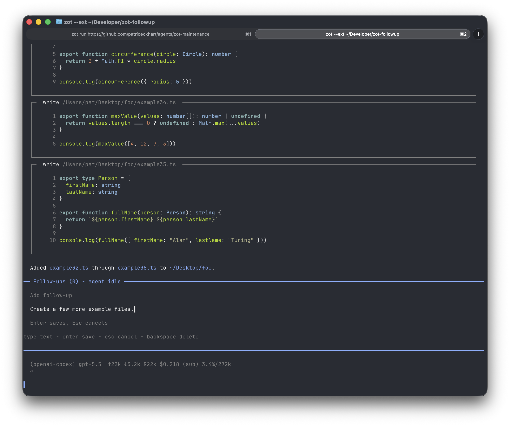

# zot-followup

A session-local follow-up queue for [zot](https://github.com/patriceckhart/zot). Add work while the agent is busy, edit or reorder it before the agent reaches it, and zot-followup submits each item after the current turn finishes.



The extension is TypeScript executed by `npx`. It has no build step, package manifest, lockfile, or local `node_modules` directory. The first launch may download `tsx` into the npm cache.

## Requirements

- zot with extension panel support and host-side line wrapping
- Node.js 18 or newer, including `npx`
- Network access on the first launch if `tsx` is not already in the npm cache

## Try it

```sh
zot ext install https://github.com/patriceckhart/zot-followup
```

Or install it globally:

```sh
zot ext install https://github.com/patriceckhart/zot-followup
```

## Commands

- `/followup <text>` queues work. If the agent is idle, that item starts immediately.
- `/followup` opens the interactive queue.

In the panel:

- Up and Down select an item.
- `a` adds an item.
- `e` edits the selected item.
- `d` deletes the selected item.
- `c` clears all pending items without stopping the active turn.
- Left and Right reorder the selected item.
- Enter submits the selected item when the agent is idle.
- Esc closes or cancels.
- Your terminal's paste shortcut inserts clipboard text while adding or editing.

Panel text wraps to the terminal width rather than a fixed character count. Pasted line breaks are preserved while editing and browsing the queue.

Clipboard paste uses `pbpaste` on macOS, PowerShell on Windows, and `wl-paste`, `xclip`, or `xsel` on Linux. Current zot releases report panel paste gestures as an `unknown` key without including the pasted text, so the extension reads the system clipboard when it receives that key while its input is active.

After a successful turn ends, the first pending follow-up is removed from the queue and submitted as a new user prompt. Tool-use boundaries do not drain the queue. If a turn is canceled or fails, pending work stays queued so it does not run unexpectedly. While a follow-up runs, the rest of the queue remains editable. Follow-ups are intentionally kept only for the current zot session and are lost when zot exits.

## Test

```sh
npx --yes tsx --test clipboard.test.ts followups.test.ts
```

## Development

Run zot directly against this directory so source changes take effect after restarting zot:

```sh
zot --ext .
```

Protocol logs are available through:

```sh
zot ext logs zot-followup
```

## License
MIT
